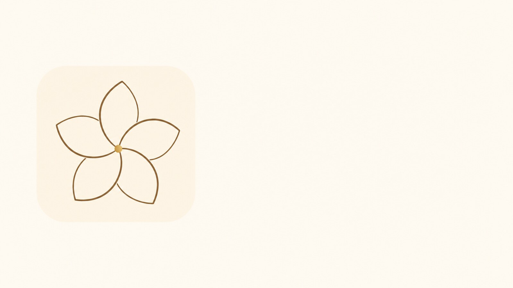

<p align="center">
  
</p>

<h1 align="center">White Plumeria</h1>

<p align="center">
  A design system for HTML, React, Vue, and Svelte.<br />
  Its own tokens. Its own CSS. No Tailwind required.
</p>

<p align="center">
  
  
  
</p>

<p align="center">
  
</p>

The flower is the product mark: five petals, one center. In the components it is drawn in `currentColor`, so it follows the theme. The pictures above are the public logo.

Packages are **not on npm**. The code samples are the API. Until a release, clone this repository.

## Start the docs

```bash
pnpm install
pnpm dev
```

The docs app listens on `0.0.0.0:5173`. It is English. Theme, direction, and reduced motion are working controls, not pictures of a settings panel.

```bash
pnpm test
pnpm --filter @white-plumeria/docs build
```

## Why this exists

Most component kits ask you to adopt their utility framework. White Plumeria does not. You import one stylesheet, pick one adapter, and keep the class names prefixed with `wpl-` so they can sit beside another system.

What you get:

| | |
| --- | --- |
| **One contract** | The same component names in React, Vue, and Svelte |
| **Own CSS** | Tokens, six themes, light and dark. `white` is the default |
| **Direction** | Logical properties. `dir="rtl"` does not flip the page with a transform |
| **Motion** | Dialogs, drawers, menus, and toasts move briefly. Reduced motion removes it |
| **No paid tier** | Patterns that other libraries sell are included. No API key for basic use |
| **Honest limits** | Unpublished, no claimed SSR, no claimed full screen-reader audit |

## Use a component

Import the CSS once. The component names match across adapters.

### React

```tsx
import { Button, WhitePlumeriaProvider } from "@white-plumeria/react";
import "@white-plumeria/styles";

export function Example() {
  return (
    <WhitePlumeriaProvider>
      <Button variant="primary">Save changes</Button>
    </WhitePlumeriaProvider>
  );
}
```

### Vue

```vue
<script setup lang="ts">
import { Button, WhitePlumeriaProvider } from "@white-plumeria/vue";
import "@white-plumeria/styles";
</script>

<template>
  <WhitePlumeriaProvider>
    <Button variant="primary">Save changes</Button>
  </WhitePlumeriaProvider>
</template>
```

### Svelte

```svelte
<script lang="ts">
  import { Button, WhitePlumeriaProvider } from "@white-plumeria/svelte";
  import "@white-plumeria/styles";
</script>

<WhitePlumeriaProvider>
  <Button variant="primary">Save changes</Button>
</WhitePlumeriaProvider>
```

### HTML

```html
<link rel="stylesheet" href="node_modules/@white-plumeria/styles/src/index.css" />
<button class="wpl-btn wpl-btn-primary" type="button">Save changes</button>
```

`@white-plumeria/elements` covers a documented subset as light-DOM custom elements. Dialog, DataTable, and Combobox stay in the framework adapters.

The intended install, once the scope exists on npm:

```bash
npm install @white-plumeria/styles @white-plumeria/react
```

That command does not work today.

## Packages

| Package | What it is |
| --- | --- |
| `@white-plumeria/tokens` | Themes, CSS variables, contrast helpers |
| `@white-plumeria/core` | Class names, catalog, calendar, table, focus helpers |
| `@white-plumeria/styles` | Prefixed CSS |
| `@white-plumeria/react` | React 19 components |
| `@white-plumeria/vue` | Vue 3 render-function components |
| `@white-plumeria/svelte` | Svelte 5 components |
| `@white-plumeria/elements` | Light-DOM custom elements for a documented subset |
| `@white-plumeria/ai` | Local planner and theme generator. No API key |
| `@white-plumeria/mcp` | Catalog MCP server. It does not call a model |
| `@white-plumeria/cli` | `wpl init`, `add`, `doctor`, `theme` |

Peers are the framework you already use.

## Themes

```html
<html data-wpl-theme="white" data-wpl-scheme="light" lang="en" dir="ltr">
```

| Theme | Character |
| --- | --- |
| `white` | Default. Paper and ink |
| `ivory` | Warm paper |
| `ink` | Dark-first |
| `saffron` | Warm accent |
| `lagoon` | Cool accent |
| `blush` | Soft accent |

Omit `data-wpl-scheme` to follow the system. Custom themes override `--wpl-color-*`. The same attributes color the docs site and the component previews.

## Motion

Dialog and drawer fade. The drawer slides from the logical side, so `start` and `end` follow writing direction. Menus, popovers, tooltips, and toasts rise in. The accordion chevron turns with the panel.

`prefers-reduced-motion: reduce` and `data-wpl-motion="reduce"` remove those transitions. Focus, names, and escape-to-close do not depend on motion.

## Direction and dates

Set `dir="rtl"` on a host page. Directional icons opt in with `wpl-icon-dir`. Dates from DatePicker and DateRangePicker are Gregorian ISO strings. Optional times are 24-hour `HH:mm`, with no seconds and no timezone name.

## Logo

| File | Use |
| --- | --- |
| [logo.jpg](apps/docs/public/brand/logo.jpg) | Square public logo |
| [social.jpg](apps/docs/public/brand/social.jpg) | Wide preview |
| [mark.svg](apps/docs/public/brand/mark.svg) | Vector mark |
| `Mark` component | Theme-colored mark inside an app |

## Not claimed

- npm publish. The `@white-plumeria` scope may still need to be created.
- A full manual screen-reader audit. The target is WCAG 2.2 AA. Automated tests cover the critical paths only.
- SSR. Dialogs call `showModal()` in the browser after mount.
- A GitHub Pages deploy from the current branch. The workflow is [`.github/workflows/pages.yml`](.github/workflows/pages.yml).

## Project

- [Contributing](CONTRIBUTING.md)
- [Security](SECURITY.md)
- [Code of conduct](CODE_OF_CONDUCT.md)
- [Changelog](CHANGELOG.md)
- [License: MIT](LICENSE)
